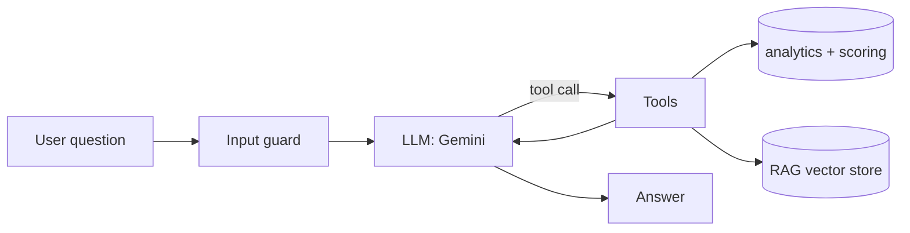

# InfluenceIQ

InfluenceIQ is an influencer intelligence engine. It analyzes public social media data and computes **engagement quality, authenticity, content consistency and audience alignment**, then combines them into an explainable **Influencer Intelligence Score (IIS)**.

It now includes **Ask InfluenceIQ**, a chat agent that answers questions about creators by calling InfluenceIQ's scoring engine as tools, with a RAG search over the scoring methodology and creators' post titles.


---

## Features

- **Engagement Quality Score (EQS):** view-based (YouTube) and follower-based (Reddit, Instagram) engagement models
- **Authenticity analysis:** heuristic detection of suspicious engagement patterns (not machine learning)
- **Niche and audience alignment:** keyword-based NLP over bios and post titles
- **Platform confidence:** reliability of each data source (YouTube > Reddit > Instagram)
- **Influencer Intelligence Score (IIS):** weighted score with a breakdown and a verdict
- **Compare two creators** side by side
- **CSV and PDF reports**
- **Ask InfluenceIQ (new):** an AI chat agent with tool calling and RAG

## Supported platforms

| Platform  | Data access  | Confidence |
|-----------|--------------|------------|
| YouTube   | Official YouTube Data API | High |
| Reddit    | Public JSON endpoints     | Medium |
| Instagram | Sample data / CSV upload  | Limited |

Instagram live scraping is intentionally not supported. Instagram analysis uses sample datasets or uploaded CSV files.

---

## Ask InfluenceIQ (AI agent)

A chat page in the Streamlit app. The LLM decides which tool to call, the code runs it, and the result goes back to the model until it can answer.



| Tool | What it does |
|---|---|
| `analyze_creator` | Collects public YouTube/Reddit data and runs engagement, authenticity, niche and IIS scoring |
| `compare_creators` | Analyzes two creators and compares them |
| `search_knowledge` | RAG: embedding search over the scoring methodology and analyzed creators' post titles |

**RAG:** documents are embedded with Gemini embeddings and stored in an in-memory vector store using cosine similarity (NumPy). Post titles are indexed when a creator is analyzed.

**Safeguards**
- Input length limit and blocking of obvious prompt-injection phrases
- Third-party text (bios, post titles) is sanitized and treated as data
- Emails, phone numbers and API-key-like strings are redacted
- Tool arguments are validated, and tool errors never crash the loop
- Step and tool-call limits, retries on rate limits and overload, cached creator data

**Example questions**
- `Analyze the YouTube channel MKBHD`
- `Compare YouTube creators MKBHD and Linus Tech Tips. Who is safer to partner with?`
- `How is the Authenticity Index calculated?`
- `What topics does MKBHD post about?`

**Limits:** only post titles and public counts are collected (no comment text). The authenticity index is a heuristic, not proof of fake followers. On the free Gemini tier, requests can hit rate limits.

---

## Quick start

### 1. Create a virtual environment and install dependencies
```
python -m venv venv
venv\Scripts\activate
pip install -r requirements.txt
```

### 2. Add your API keys
Copy `.env.example` to `.env` and fill it in:
```
GEMINI_API_KEY=your_gemini_key
YOUTUBE_API_KEY=your_youtube_data_api_key
```
- Gemini key: https://aistudio.google.com/apikey
- YouTube key: create an API key in Google Cloud and enable **YouTube Data API v3**

Optional: set `GEMINI_MODEL` or `GEMINI_EMBED_MODEL` in `.env` if the default model names are unavailable.

### 3. Run the dashboard
```
python -m streamlit run influenceiq/dashboard/app.py
```
Open `http://localhost:8501`. Use the sidebar to switch between the analysis dashboard and **Ask InfluenceIQ**.

### 4. Run the tests
```
python -m pytest
```
The tests run offline with a fake LLM, so they need no API keys.

---

## Project structure

```
influenceiq/
├── influenceiq/
│   ├── agent/         # Ask InfluenceIQ: agent loop, tools, RAG, guardrails, LLM client
│   ├── collector/     # YouTube, Reddit, Instagram data collection
│   ├── analytics/     # engagement, authenticity, NLP / niche
│   ├── scoring/       # IIS computation
│   ├── reports/       # CSV / PDF export
│   ├── storage/       # JSON and SQLite storage
│   ├── dashboard/     # Streamlit app (+ pages/ for the chat)
│   └── config/        # settings (reads keys from .env)
├── sample_data/       # Instagram sample data and CSV template
├── tests/             # offline tests for the agent
├── .env.example
├── requirements.txt
└── README.md
```

## Tech stack
Python, Streamlit, Pandas, NumPy, YouTube Data API, Reddit public API, Gemini (OpenAI-compatible API), pytest
